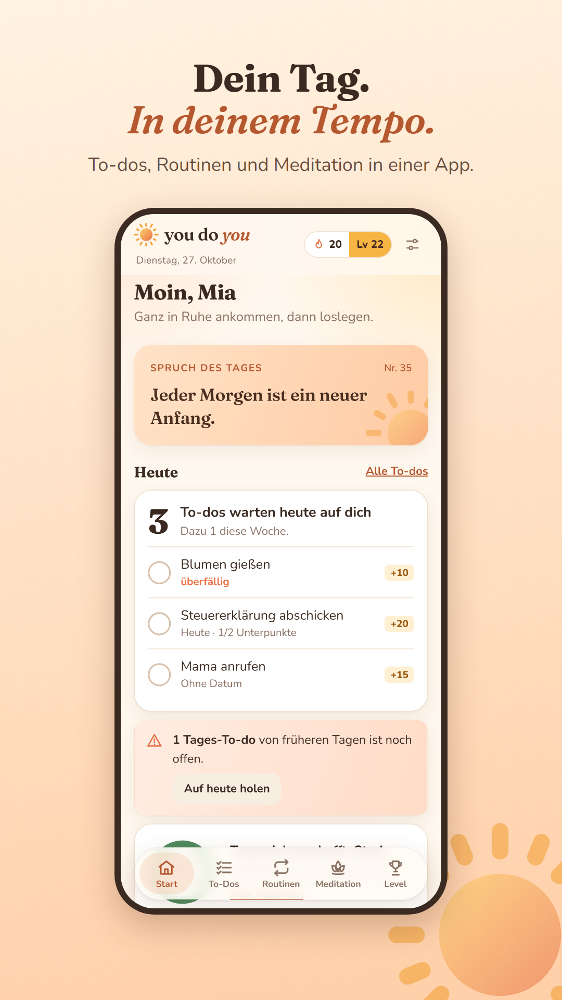
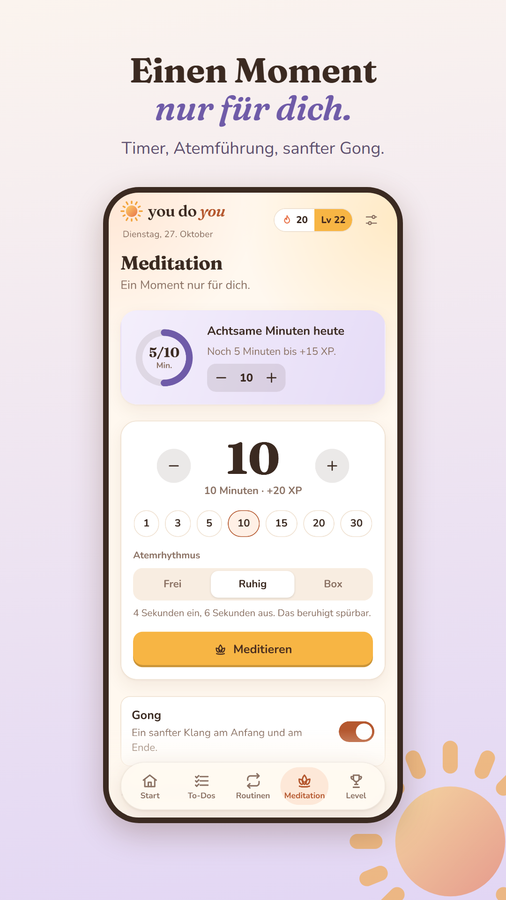
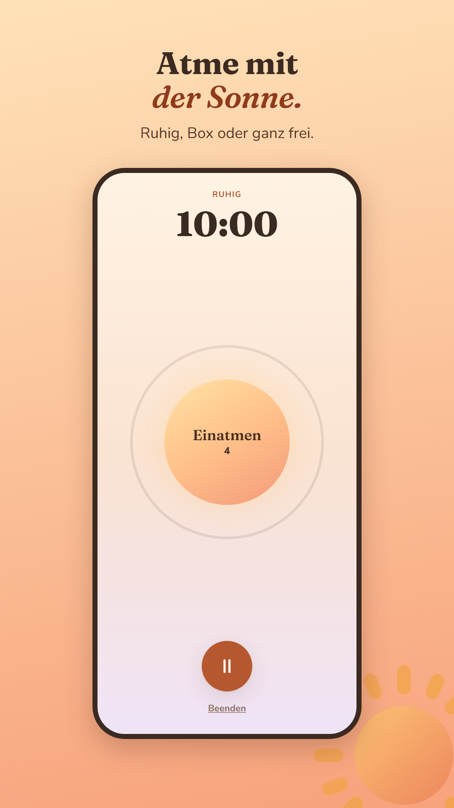
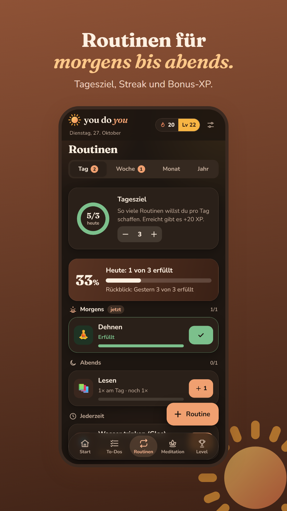

# You Do You

Eine warme, sanft gamifizierte App für **To-dos**, **Routinen** und **Meditation**. Wer abhakt, sammelt XP, steigt im Level auf (vom Samenkorn bis zum Leuchtturm), hält eine Streak und schaltet Abzeichen frei. Ohne Konto, ohne Werbung, auf Deutsch und Englisch. Läuft als Web-App sowie als App für Android und iOS aus einer Codebasis.

| | | | |
|---|---|---|---|
|  |  |  |  |

**Web-Version:** https://seran2409.github.io/you-do-you/

Schwester-App mit klarem Schwarz-Gelb-Design: [Haven't Done It Yet!](https://github.com/Seran2409/havent-done-it-yet).

## Was drin ist

- **To-dos:** Aktuell, Woche, Monat, Jahr, Unterpunkte, Schwierigkeit
- **Routinen:** Tag, Woche, Monat, Jahr, nach Tageszeit (morgens, mittags, abends), Tagesziel, Rückblick
- **Meditation:** Timer von 1 bis 120 Minuten, Atemführung (frei, ruhig 4–6, Box 4-4-4-4), Gong, Bildschirm bleibt an, eigene Erinnerungen pausieren, Tagesziel für achtsame Minuten, Stimmung danach, Verlauf
- **Spiel:** XP (2 XP pro Meditationsminute, +15 fürs Tagesziel), Level, 18 Abzeichen, Streak, Heatmap
- **Erinnerungen:** morgens, abends, Achtsamkeits-Pause

## Leitfäden

| Dokument | Inhalt |
|---|---|
| [docs/VEROEFFENTLICHEN.md](docs/VEROEFFENTLICHEN.md) | App Store und Google Play, komplett von Windows aus |
| [docs/store/STORE-TEXTE.md](docs/store/STORE-TEXTE.md) | Name, Untertitel, Beschreibung, Schlüsselwörter, Datenschutz-Angaben (DE/EN) |
| [docs/MONETARISIERUNG.md](docs/MONETARISIERUNG.md) | Pro-Version, faire Werbung, Rechenbeispiel |
| [docs/PROMOTION.md](docs/PROMOTION.md) | ASO, Social-Media-Formate, Zeitplan bis Januar |
| [docs/ENTSCHEIDUNG-STACK.md](docs/ENTSCHEIDUNG-STACK.md) | Technik, Konten, Erkenntnisse |

## Starten

Voraussetzung: Node.js 22 oder neuer. **Den Projektordner nicht in OneDrive ablegen**; OneDrive macht aus `node_modules` Cloud-Platzhalter, an denen der Bundler scheitert.

```bash
npm install
npm run web
```

## Prüfen

```bash
npm run verify       # Sprachdateien, Typen, Unit-Tests
npm run export:web   # statischer Web-Export nach dist/
npm run test:e2e     # Browser-Abläufe (einmalig: npx playwright install chromium)
```

## Rechtstexte, Icons, Klang, Store-Grafiken

```bash
npm run legal                     # Datenschutz, AGB, Impressum, Hilfe (DE/EN) aus legal.config.json
npm run icons                     # App-Icon, Splash (hell/dunkel), Benachrichtigungs-Icon, Web-Icons
node scripts/make-sounds.mjs      # Gong für die Meditation
node scripts/store-assets.mjs http://localhost:8090/you-do-you/   # Store-Screenshots (vorher: npm run serve:web)
```

## Aufbau

```
src/app/              Routen: Start, To-Dos, Routinen, Meditation, Level, Sitzung
src/features/         Bildschirme (meditate/: Tab, Sitzung, Atem-Sonne)
src/game/             Spiellogik ohne UI: XP inkl. Meditation, Level, Streak, Abzeichen, Atemzyklen, Erinnerungsplan
src/data/             lokaler Speicher (Web: IndexedDB, Apps: SQLite), Import/Export
src/meditation/       Gong
src/notifications/    lokale Erinnerungen (Android/iOS)
locales/              de.json, en.json
public/legal/         Rechtstexte (erzeugt)
docs/store/           Store-Texte, Screenshots, Feature-Grafiken
```

---

## English

**You Do You** is a warm, gently gamified app for to-dos, routines and meditation: earn XP, level up, keep a streak, unlock badges. No account, no ads, German and English, one codebase for web, Android and iOS.

- Run: `npm install`, then `npm run web` (keep the project folder out of OneDrive).
- Checks: `npm run verify`, `npm run test:e2e`.
- Release from Windows with EAS: see [docs/VEROEFFENTLICHEN.md](docs/VEROEFFENTLICHEN.md).
